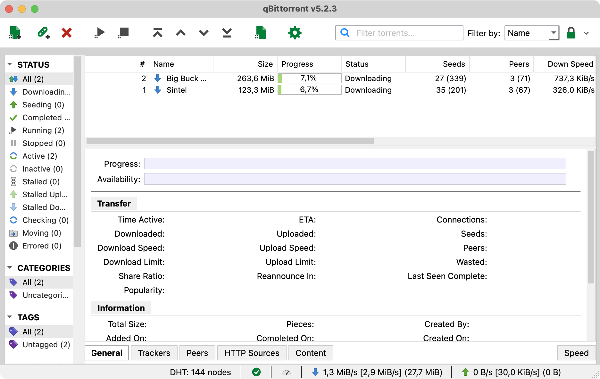
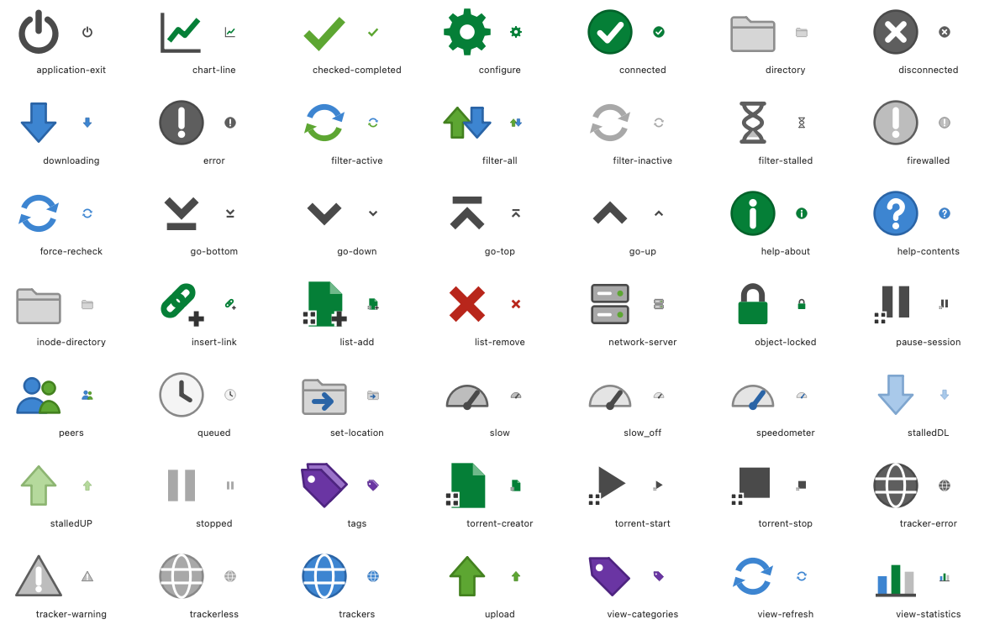

# uTorrent Light

A light, flat theme for qBittorrent 5 in the spirit of classic µTorrent 3.3.



## Install

1. Download [`uTorrent-Light.qbtheme`](uTorrent-Light.qbtheme) and keep it somewhere permanent.
2. In qBittorrent, open **Preferences → Behavior → Interface** and set:
   - Style: **Fusion**
   - Color scheme: **Light**
   - **Use custom UI Theme** → select the file
3. Restart qBittorrent.

Tested with qBittorrent 5.2.3 on macOS.

## Icons



All 49 icons are original drawings. No µTorrent assets are included.

## Build from source

The sources live in `src/`. Rebuild the theme file with Qt 6 `rcc`:

```sh
cd src && rcc --binary --compress-algo zlib resources.qrc -o ../uTorrent-Light.qbtheme
```

## License

[MIT](LICENSE). Not affiliated with µTorrent or BitTorrent Inc.
